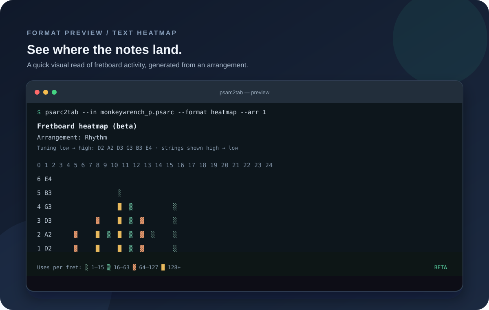
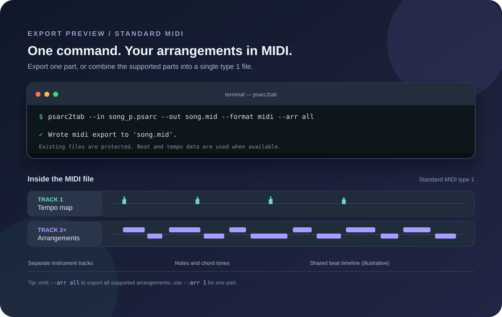
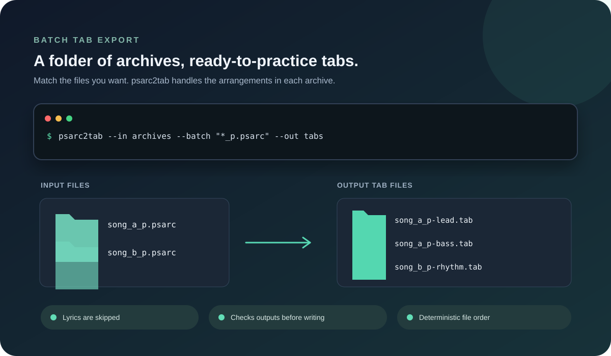
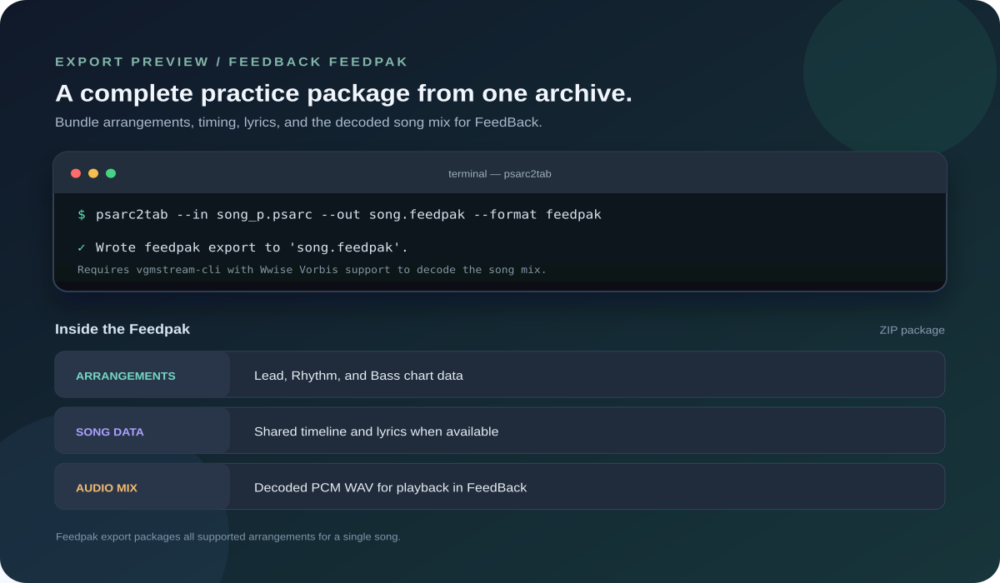

# psarc2tab

[](https://github.com/nma76/psarc2tab/actions/workflows/ci.yml)
[](https://github.com/nma76/psarc2tab/actions/workflows/release.yml)
[](https://github.com/nma76/psarc2tab/releases/latest)

## One Rocksmith archive. Tabs, MIDI, Feedpak (beta), and more.

Turn supported Rocksmith PSARC archives into practice and analysis files.
Export Lead, Rhythm, and Bass arrangements as ASCII tabs, Standard MIDI, or
beta Feedpak packages; inspect fretboard patterns with heatmaps and review
archive or arrangement statistics. You can also export timed lyrics as LRC
files and batch-export tabs. Runs from the command line on Windows, macOS, and
Linux.

## See it in action

<table>
  <tr>
    <td width="50%"><strong>Fretboard heatmap</strong><br></td>
    <td width="50%"><strong>MIDI export</strong><br></td>
  </tr>
  <tr>
    <td width="50%"><strong>Batch tab export</strong><br></td>
    <td width="50%"><strong>Feedpak export (beta)</strong><br></td>
  </tr>
</table>

## Usage

Download a ready-to-run package from
[Releases](https://github.com/nma76/psarc2tab/releases/latest), or build from
source as described under [Development](#development).

```sh
# List arrangements, then export all supported instrument arrangements
psarc2tab --in song_p.psarc --list
psarc2tab --in song_p.psarc --out song.tab

# Export one arrangement, MIDI, lyrics, or a heatmap
psarc2tab --in song_p.psarc --out lead.tab --arr 1
psarc2tab --in song_p.psarc --out song.mid --format midi
psarc2tab --in song_p.psarc --out lyrics.lrc --arr 4
psarc2tab --in song_p.psarc --format heatmap

# Inspect archive and arrangement statistics; batch-export tabs
psarc2tab --in song_p.psarc --stats
psarc2tab --in archives --batch "*_p.psarc" --out tabs

# Export a beta Feedpak package (requires vgmstream-cli; see Requirements)
psarc2tab --in song_p.psarc --out song.feedpak --format feedpak
psarc2tab --help
```

By default, export includes every supported Lead, Rhythm, and Bass arrangement;
use `--arr <number>` to select one. `--arr all` is equivalent to omitting the
option. The numbered choices come from `--list`. Lyrics are exported by
selecting their listed number. Tab output uses the requested path as a base
name and adds instrument suffixes, for example `song-lead.tab` and
`song-bass.tab`. Existing files are never overwritten. Batch patterns match
filenames in the input directory only; `*` matches any sequence and `?` one
character. Batch export currently supports tabs only.

Available formats are `tab`, `midi`, `heatmap`, and `feedpak`. Selecting a
Lyrics entry exports an LRC file. MIDI combines all selected arrangements into
one type-1 file; use `--drums` with `--format midi` to add an optional synthetic
beat. Heatmaps can be printed to the terminal or saved as text. `--stats`
reports archive details and per-arrangement note, technique, string, and fret
statistics without creating an output file.

## Requirements

Released platform packages are self-contained and do not require a separate
.NET installation. Building from source requires the [.NET 10 SDK](https://dotnet.microsoft.com/download/dotnet/10.0).

Only beta Feedpak export needs the external `vgmstream-cli` decoder, built with
Wwise Vorbis (`libvorbis`) support. Get platform builds from the
[official vgmstream releases](https://github.com/vgmstream/vgmstream-releases/releases).
The executable must be on `PATH`, or set `PSARC2TAB_VGMSTREAM` to its full path.
For example, set the variable in the terminal before running psarc2tab:

```sh
# macOS / Linux
export PSARC2TAB_VGMSTREAM="/path/to/vgmstream-cli"
```

```powershell
# Windows PowerShell
$env:PSARC2TAB_VGMSTREAM = "C:\path\to\vgmstream-cli.exe"
```

If no suitable build is available, see the upstream
[build guide](https://github.com/vgmstream/vgmstream/blob/master/doc/BUILD.md).
The decoder is not bundled with psarc2tab. See its
[license notice](https://github.com/vgmstream/vgmstream/blob/master/COPYING)
and the terms for the specific build you install.

## Known limitations

- Support is based on observed PSARC layouts and tested PC examples. XML and
  SNG charts are supported; no SNG-based Mac archive has been verified.
- Imports select the full difficulty for each phrase iteration. Phrase
  structure, anchors, and hand shapes are not exported. Nonzero song offsets
  are rejected while their meaning is unverified.
- MIDI uses available beat and tempo data, or falls back to 120 BPM when there
  are too few beat markers. Note techniques are not encoded. Events without a
  duration ring until the next onset; this duration rule has not been compared
  with playback in Rocksmith or common MIDI players.
- Feedpak is beta and currently supports single-song archives with one or two
  WEM files. It does not include cover art or difficulty ladders; some technique
  details are not represented. Capo is taken from XML only and does not change
  fret positions.
- Heatmaps show counts by string and fret, not timing or recommended fingering.
- Lyrics use the observed `*_vocals` entry naming. Mac SNG lyric parsing has
  synthetic test coverage only.

For confirmed format observations and remaining questions, see
[Rocksmith format facts](docs/rocksmith-format-facts.md).
## Development

```sh
dotnet build Psarc2Tab.slnx
dotnet test Psarc2Tab.slnx
```

Pushes to `develop` run the Release build and full test suite. Stable semantic
version tags such as `v1.2.3` create self-contained packages for `win-x64`,
`osx-arm64`, `linux-x64`, and `linux-arm64`, attached to a GitHub Release with
SHA-256 checksums.
