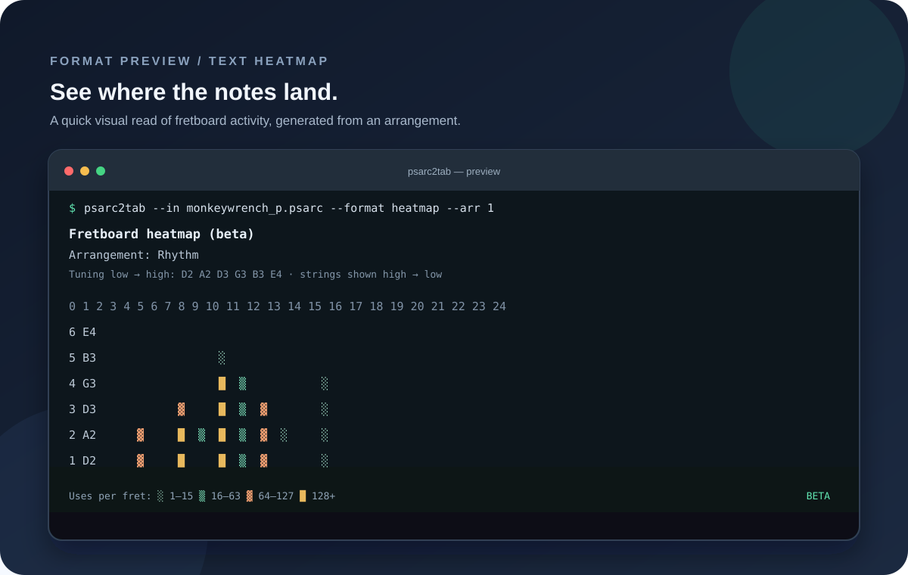
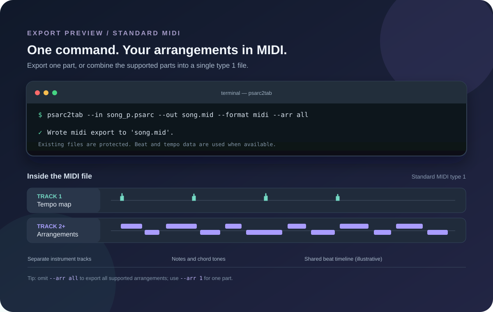
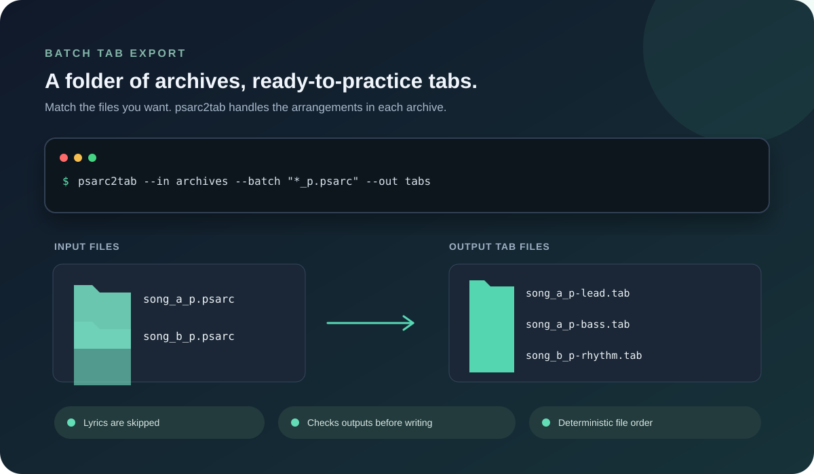

# psarc2tab

[](https://github.com/nma76/psarc2tab/actions/workflows/ci.yml)
[](https://github.com/nma76/psarc2tab/actions/workflows/release.yml)
[](https://github.com/nma76/psarc2tab/releases/latest)

## From Rocksmith archive to practice-ready tab

Turn supported Rocksmith PSARC archives into useful practice and analysis
files. Export Lead, Rhythm, and Bass arrangements as readable ASCII tabs,
Standard MIDI, or FeedBack-compatible `.feedpak` packages; inspect fretboard
note patterns with text heatmaps and review archive and arrangement statistics
before choosing what to export. Tabs include tuning and song sections; MIDI
uses available beat and tempo data. You can also export timed lyrics as LRC
files or batch-export tabs from a folder. Feedpak export needs the separate
`vgmstream-cli` decoder with Wwise Vorbis support. `psarc2tab` runs from the
command line on Windows, macOS, and Linux.

## See it in action

### Fretboard heatmap



### MIDI export



### Batch tab export



## Requirements

- .NET 10 SDK
- `vgmstream-cli` with Wwise Vorbis support (libvorbis), only for Feedpak export

## Build

```sh
dotnet build Psarc2Tab.slnx
```

## Test

```sh
dotnet test Psarc2Tab.slnx
```

## CI and releases

Pushes to `develop` run the Release build and full test suite. Pushing a stable
semantic-version tag such as `v1.2.3` runs the same checks, then creates
self-contained single-file CLI packages for `win-x64`, `osx-arm64`, `linux-x64`,
and `linux-arm64`. Release tags must point to a commit in `develop`. Each
platform package is attached to a GitHub Release along with `SHA256SUMS.txt`.

## Usage

The CLI accepts:

```sh
psarc2tab --in <input.psarc> --out <output.tab>
psarc2tab --in <input.psarc> --list
psarc2tab --in <input.psarc> --stats
psarc2tab --in <input.psarc> --stats --arr <number|all>
psarc2tab --in <input.psarc> --out <output.tab> --arr <number>
psarc2tab --in <input.psarc> --out <output.tab> --arr all
psarc2tab --in <input.psarc> --out <song.mid> --format midi --arr all
psarc2tab --in <input.psarc> --out <song.mid> --format midi --drums
psarc2tab --in <input.psarc> --out <song.feedpak> --format feedpak
psarc2tab --in <input.psarc> --out <output.tab> --format tab
psarc2tab --in <archive-directory> --batch "*_p.psarc" --out <tab-directory>
psarc2tab --in <input.psarc> --out <output.mid> --format midi
psarc2tab --in <input.psarc> --format heatmap
psarc2tab --in <input.psarc> --arr <number> --format heatmap
psarc2tab --in <input.psarc> --out <output.txt> --format heatmap --arr <number>
psarc2tab --in <input.psarc> --out <lyrics.lrc> --arr <lyrics-number>
psarc2tab --help
psarc2tab --version
```

`--in` and `--out` may be supplied in either order. All options use double-dash
syntax. The input must exist and be readable. The output directory must exist
and be writable for file exports, and an existing output file is never
overwritten. File output is written to a temporary file in the destination
directory and moved into place only after writing completes. `--list` extracts the archive manifest and
displays numbered Lead, Bass, and Rhythm arrangements, followed by Lyrics when a
matching vocal chart is present. It recognizes XML charts under `songs/arr/` and SNG charts
referenced by arrangement JSON manifests. Use the displayed number with
`--arr` to select an item. By default, conversion exports all supported Lead,
Bass, and Rhythm arrangements; tab files receive instrument-specific suffixes.
Use `--arr <number>` to export one item. Selecting a Lyrics number writes
timestamped plain-text LRC output instead of tablature. `--stats` prints archive
details and statistics for every instrument arrangement without writing a
file. Add `--arr <number>` to show
statistics for one numbered arrangement; selecting the Lyrics number reports
that instrument statistics do not apply. `--arr all` is equivalent to omitting
`--arr`. Song title, artist, album, and year are shown once using metadata from
the first instrument arrangement. Rocksmith XML can contain album name and
year, while SNG JSON metadata may omit them; missing values display as
`unavailable`. With statistics, note and technique counts include individual
note events, while chord tones contribute to used
strings and fret range. Length is the latest imported event end, or onset when
the source duration is zero. Platform is inferred only when platform-specific
SNG paths identify PC or Mac. `--format` selects the
arrangement output format and defaults to
`tab`; supported arrangement formats are `tab`, `midi`, and the beta text
`heatmap`. MIDI export writes notes and chord tones from the selected
arrangement(s) to a Standard MIDI File. Add the opt-in beta flag `--drums` with
`--format midi` to append a generated percussion track; the flag is rejected
with other output formats.
It uses 960 ticks per quarter note and derives tempo changes from Rocksmith XML
`ebeats` or decoded SNG beat times;
when fewer than two beat markers are available, it falls back to 120 BPM and
converts absolute seconds to ticks.
A song-level cent offset is sent as channel pitch bend. No time-signature
metadata is emitted because the current domain model does not contain it. Lead
and Rhythm use the General MIDI clean electric guitar program; Bass uses
fingered electric bass. Note articulations and other playing techniques are
not encoded, and playback sound depends on the receiving sequencer or
synthesizer. Positive source sustain durations are preserved through tempo
changes. Events without a duration ring until the next onset anywhere in the
arrangement; an event with no later onset uses a one-tick minimum. Duration
inference and playback have not yet been compared with Rocksmith, GarageBand,
or Windows Media Player. Lyrics remain LRC exports. Unknown formats are
rejected with a list of available formats.

Feedpak export writes all instrument arrangements, optional lyrics, a song
timeline, and a complete WAV mix into one `.feedpak` file. It requires
`vgmstream-cli` on `PATH`, built with Wwise Vorbis support (libvorbis); set
`PSARC2TAB_VGMSTREAM` to its executable path when it is installed elsewhere.
Download a platform build from the
[official vgmstream releases](https://github.com/vgmstream/vgmstream-releases/releases).
If no suitable build is available for your system, follow the upstream
[build guide](https://github.com/vgmstream/vgmstream/blob/master/doc/BUILD.md)
and include libvorbis support; without it, Wwise Vorbis `.wem` files cannot be
decoded. On Windows the executable is normally named `vgmstream-cli.exe`.
After installation, either put the executable on `PATH` or set
`PSARC2TAB_VGMSTREAM` to its full path. Verify the installed build by generating
a Feedpak; merely launching the CLI does not confirm that Vorbis decoding is
enabled.
The tool is not bundled or redistributed by this project. The CLI invokes it
to decode Wwise WEM audio into PCM WAV. `vgmstream`
uses the ISC license; consult its
[copyright and license notice](https://github.com/vgmstream/vgmstream/blob/master/COPYING)
and the terms for the particular build you install. This project does not
charge a separate license fee for that external decoder. No `vgmstream`
source or binary is included in this repository or its release packages.

The initial feedpak exporter supports single-song archives with one or two WEM
files and identifies the full mix from their relative uncompressed sizes.
Archives with multiple songs, ambiguous WEM layouts, missing WEM audio, or
unsupported WAV variants fail with a diagnostic. Only PCM WAV output is
accepted. Feedpak does not currently include PSARC cover art. Arrangement
difficulty levels and some Rocksmith technique detail are not represented;
capo metadata is not yet imported. These mapping limits are being addressed
before this format is considered complete. Packages have not yet been opened
and checked in the FeedBack application. The writer targets the
[Feedpak v1 specification](https://github.com/got-feedBack/feedpak-spec/blob/main/spec/feedpak-v1.md)
(currently declared as version `1.19.0`). Lyric syllable durations are retained
when present. The current domain model cannot preserve capo, exact bend
magnitude/shape, or slide target fret, and it does not export difficulty ladders;
those source details are omitted rather than fabricated.

Third-party notices: `vgmstream` is an optional external executable and is not
distributed with `psarc2tab`; users who obtain it must retain and follow the
upstream notices applicable to their build. The repository does not currently
bundle third-party source or binaries for Feedpak export. The GitHub repository
description must be updated to mention the optional `vgmstream-cli` dependency
and its licensing; that external page change requires maintainer access.

With the default `tab` format, every instrument arrangement is exported as a
separate file; Lyrics entries are excluded. The requested output filename is a
base name, so `mysong.tab` produces files such as `mysong-lead.tab` and
`mysong-bass.tab`. Repeated arrangements of the same instrument receive
numbered suffixes such as `mysong-lead-2.tab`. `--arr all` may be supplied
explicitly for the same behavior. For tab batch export, pass an input directory
to `--in`, a filename wildcard to `--batch`, and an existing output directory
to `--out`. For example, `psarc2tab --in archives --batch "*_p.psarc" --out tabs`
exports every matching archive in case-insensitive filename order. Patterns
match filenames in the input directory only; `*` matches any sequence and `?`
matches one character. Each archive writes all its instrument arrangements,
excluding Lyrics, using its filename stem and the regular instrument suffixes.
Only `tab` is supported for batch export. No matching files, an invalid archive,
or any output collision fails the whole batch before files are committed.
With `--format midi`, the default selection
writes one Standard MIDI type-one file to the
requested output path. It contains a conductor track with the shared tempo map,
followed by one named track per arrangement in archive order. Each arrangement
uses its own melodic MIDI channel so overlapping parts do not share program or
pitch-bend state; the percussion channel is left unused by default. Add
`--drums` with `--format midi` to append a synthetic percussion track in both
single and combined exports (beta). It places hi-hat on every beat, kick on
beat 1, and snare on beat 3, using General MIDI percussion notes on channel 10. This is
a generic metronomic accompaniment and does not represent the song's actual
drum performance. Drum export requires a continuous 4/4 beat grid containing
at least one full measure; it fails with a clear error when that grid is
missing or inconsistent. A truncated final measure is allowed, and only its
observed beats receive hits. Tempo changes follow the same beat-derived tempo
map as the arrangement. Combined export
requires every arrangement to have identical beat timestamps, and supports up
to 15 arrangements so each can use an independent melodic channel. Arrangements
with different beat timestamps can be exported separately. Only the
supported, named Lead, Rhythm, and Bass arrangements shown by `--list` are
included; Lyrics and other unrecognized archive entries are not exported. All
destination paths are checked before export, existing files are never
overwritten, and staged files are removed if any import or write fails. A
successful export prints each destination to stdout. Without `--out`,
`--format heatmap` renders the selected arrangement(s) on screen; the default
selection shows every instrument arrangement, with a blank line between
heatmaps. `--arr <number>` shows one. The CLI uses standard .NET console colors
for shading only when stdout is an interactive console. Redirected output is
plain UTF-8 text, and setting `NO_COLOR` disables terminal colors. To save a
heatmap instead, provide a `.txt` output name; when all arrangements are
selected, each heatmap receives an instrument suffix like other
single-arrangement formats.

### Exit codes

| Code | Meaning |
| ---: | --- |
| 0 | Help, version, or export completed |
| 2 | Invalid arguments |
| 3 | Input file cannot be read |
| 4 | Output destination cannot be written |
| 5 | Arrangement or lyrics could not be exported |
| 6 | The selected archive item number is unavailable |

## Known limitations

- XML and SNG imports select the full difficulty independently for each phrase
  iteration. Both skip notes marked
  `ignore` and import section headings, but not phrase structure, anchors, or
  hand shapes. Section headings are omitted when no note or chord starts in
  their time interval; names such as `NoGuitar1` alone never suppress content.
  Nonzero song offsets are rejected while their meaning is unverified. Observed
  chord events have no duration field and are imported with zero duration.
- Arrangement XML whose declared instrument does not match its selected archive
  entry is rejected.
- The Domain model represents songs, tracks, string tunings, timed notes and
  chords, fretted positions, and a first set of note techniques. Timeline values
  use `TimeSpan`; see the format facts document for the supported XML mapping.
- Current PSARC support covers header and index inspection plus extraction of
  one entry at a time for the observed PC and Mac archive layouts. XML charts
  and decoded SNG charts can be converted for the observed PC examples. SNG
  chart import selects each phrase iteration's full difficulty and maps notes,
  chord templates, timing, tuning, supported techniques, and section headings.
  No SNG-based Mac archive has been verified yet.
- Vocal charts are exported as LRC text with line start timestamps. Rocksmith's
  explicit `+` line marker is honored; unmarked lyric fragments are grouped and
  wrapped at 80 characters. LRC files use LF line endings on every platform.
  SNG vocal parsing uses the declared PC/Mac path to
  choose byte order; the Mac lyric record layout has synthetic test coverage
  only. Only the observed `*_vocals` entry naming is recognized.

## PSARC header and index inspection

The header reader currently recognizes the common 32-byte header layout in
the sampled PC and Mac archives. Both report version 1.4, zlib
compression, 30-byte TOC entries, 28 entries, 65,536-byte blocks, and raw
archive flags `0x4`. Their TOC sizes differ: 1,128 bytes for PC and 1,130 bytes
for Mac. The header reader supports raw flags `0x0` and `0x4`. Flag `0x4` marks
an encrypted TOC; the index reader decrypts it with AES-256 CFB and reads each
30-byte record (path digest, first block index, 40-bit uncompressed length,
and 40-bit archive-relative data offset) followed by 16-bit block sizes.
The index reader validates record bounds and limits the TOC payload to 64 MiB.
Both sampled archives have 28 entries; the PC index has 128 block sizes and
the Mac index has 129. The CLI extracts the manifest entry and uses its
verified line-to-index ordering to resolve archive paths. `--list` displays
Lead, Bass, and Rhythm arrangements from either XML charts or JSON/SNG packages;
vocals and show-light data are not listed as tablature instruments.

The entry extractor handles raw blocks (both zero-size markers and recorded
sizes equal to the expected uncompressed block length) and zlib-compressed
blocks. It processes one block at a time, validates each block against the
declared uncompressed length, and writes to a caller-provided stream. The
manifest entry was extracted from both sampled archives and the CLI lists
their instrument arrangements. Arrangement numbering follows each archive's
manifest order, so the same instrument can have a different number in a PC
and Mac archive.

See [Rocksmith format facts](docs/rocksmith-format-facts.md) for confirmed
observations from the sampled PC and Mac archives and details that remain
unknown.

## ASCII tablature output

Output starts with `Artist`, `Song`, and `Tuning` metadata lines. Tuning is
listed from the lowest string to the highest, using note names with MIDI octave
numbers. `Tuning reference` shows the A4 reference frequency calculated from
the arrangement's cent offset relative to 440 Hz. The tablature then uses the
familiar six-line layout, with the highest string on top and the lowest string
on the bottom. String labels are derived
from the track's open-string pitches; fret numbers and chord tones share
aligned horizontal columns. Hammer-ons, pull-offs, bends, slides, vibrato,
harmonics, muted notes, and other currently modeled techniques use compact
ASCII markers.

Horizontal spacing is approximate: one column represents about 125 ms, with
long gaps capped for readability. The current Domain model does not include
measure boundaries, so row-ending `|` characters wrap the display and do not
claim to represent verified musical bars. Song metadata is not embedded in the
tab text. The provided plain-text tab sample shows the target visual style.

## Text fretboard heatmap (beta)

Use `--format heatmap` to show a text heatmap for one arrangement or for all
instrument arrangements; add `--out <file.txt>` to save the output. Each
standalone note and each chord tone adds one use to its string/fret position.
Strings are shown from highest pitch to lowest,
with their string number and open pitch; open-string notes appear at fret 0.
The grid always includes frets 0 through 24 so separate heatmaps share the
same baseline, and expands up to the highest fret used (maximum 37). Charts
using a higher fret are rejected with an explanation instead of producing an
unbounded output grid.

Heatmap symbols use fixed absolute count ranges across files: blank for zero,
`░` for 1–15 uses, `▒` for 16–63, `▓` for 64–127, and `█` for 128 or more. The
ranges were selected after counting fret-position uses across 20 distinct
arrangement examples; they keep the four shaded levels useful across both
short and dense arrangements. The output includes a legend and the highest
count at any position. The grid is UTF-8 text and uses Unicode block-shading
characters. This first beta view compares position use by count; it does not
represent timing, note duration, or a recommended fingering.
